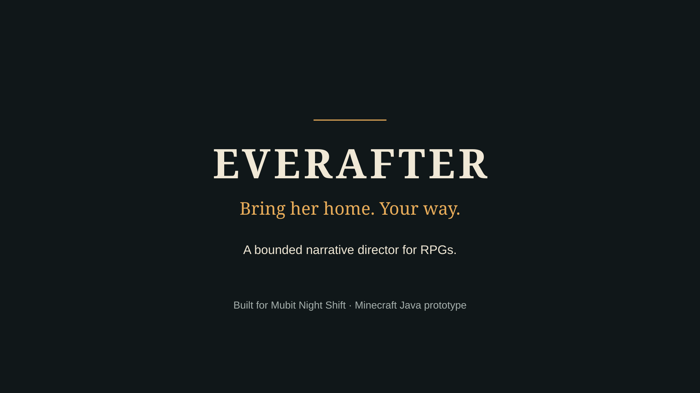
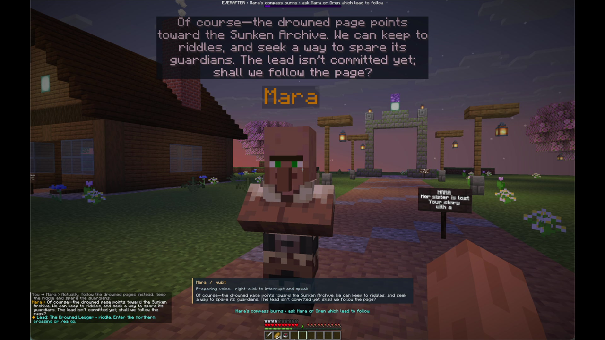
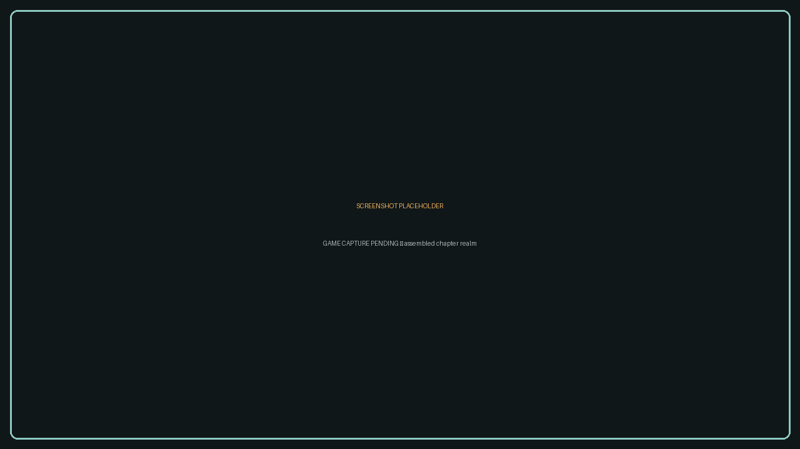
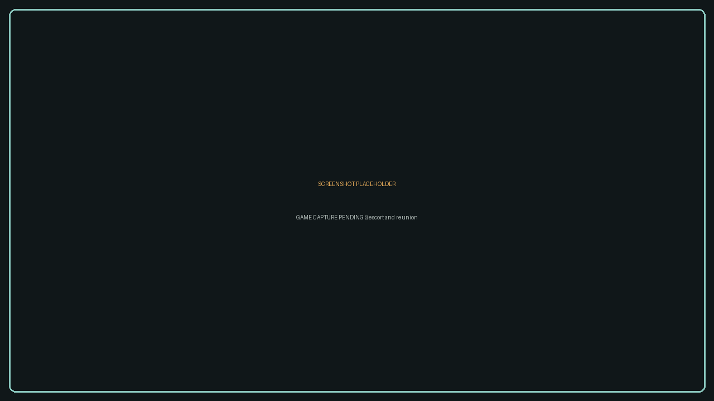
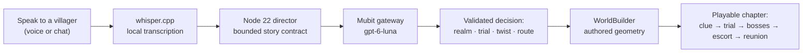
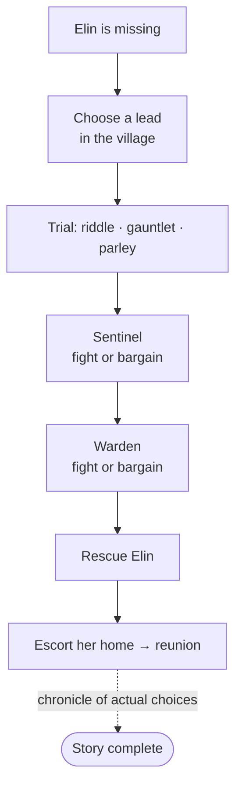

<div align="center">



### A graph-based Minecraft adventure that turns conversation into a playable world

Tell the characters what kind of journey you want — the director interprets your words,
and the server builds the chapter you chose, block by block.

[](https://github.com/anshulyadav1976/mubit-hackathon/actions/workflows/check.yml)


**Built for Mubit Night Shift** · [Demo guide](docs/demo.md) · [Quest graph](docs/quest-graph.md) · [Submission evidence](docs/submission-evidence.md)

</div>

---

Mara's sister **Elin is missing**. In the village, Mara and the archivist Oren offer four leads: a burning compass, a drowned page, a bell above the clouds, a thornwood ribbon. Answer in your own words — by voice or chat — and a Mubit-backed director interprets your answer into a realm, a trial, an atmosphere, a difficulty and a twist. Then the Paper server physically builds that chapter in a fresh world: terrain, paths, clues, barriers, bosses. Fight or bargain past the Sentinel and the Warden, escort Elin home, and the ending chronicle records only the choices you actually made.

The model proposes. **The server validates.** No generated sentence can award progress it didn't earn.

EVERAFTER is for story-driven players who want an adventure that answers *them* — and for anyone who's felt a quest log go stale. The adaptation matters because the story stops being a script the moment it starts listening: two players can say different things, walk into different realms, and both finish a game that feels written for their playthrough alone.

## See it

<table>
<tr>
<td width="33%"><a href="docs/assets/screenshot-village.png"></a></td>
<td width="33%"><a href="docs/assets/screenshot-realm.png"></a></td>
<td width="33%"><a href="docs/assets/screenshot-reunion.png"></a></td>
</tr>
<tr>
<td align="center"><strong>Choose a lead with Mara</strong></td>
<td align="center"><strong>Enter the Sunken Archive</strong></td>
<td align="center"><strong>Bring Elin home</strong></td>
</tr>
</table>

Stills from recorded gameplay. Click an image to view it at full size.

## How it works



Four authored realms × three trials × three twists = **36 chapter configurations**, each assembled live from authored geometry — plus variation in approach, atmosphere, difficulty, dialogue and guardian outcomes.



Every edge in the graph is guarded by real evidence: a discovered clue, a trial artifact, an actual boss outcome. Mercy shown to the Sentinel changes what the Warden accepts.

## Why EVERAFTER

One application. All three tracks, covered end to end — not adjacent demos, one system where each track feeds the next:

**Recurring tasks.** Every turn in the game is the same task: interpret one player's words against authoritative facts, return one bounded decision. That contract never changes across all six NPCs and every phase — which is exactly the stable, repeated workload Mubit learns from. One hundred real candidate turns, all valid story JSON, flowed from production into the submission corpus. See [corrections](docs/corrections.md) for a preference flip reshaping the very next decision.

**Own your intelligence layer.** The intelligence isn't the model alone — it's the contract around it: a frozen prompt, a strict schema, evidence-gated edges, a labelled fallback, and a corpus of 240 authored + 60 held-out turns we own outright. The model proposes; the server decides. Swapping the gateway changes nothing about who owns the behavior.

**Fast refresh.** Corrections apply mid-conversation: say "actually, no combat — I'd rather solve the riddle," and the next decision moves route, trial and realm together. Between the game and the submission pipeline, the runner replays the frozen corpus and rebuilds the evidence pack — refresh is a loop, not a rebuild.

Against every judging criterion, this is the strongest honest case the project can make:

| Criterion | Why it earns full marks |
| --- | --- |
| **Use of Mubit** | Every story sentence routes through Mubit — nothing else can write narrative. 13/13 production replies, zero fallbacks, zero errors in a completed campaign, with request IDs on file. |
| **Usefulness** | This isn't a demo shaped like a game; it's a game that works. Voice in, world out, ending earned — and the same director contract is reusable by any narrative project tomorrow. |
| **Technical execution** | A server-authoritative state machine, 36 authored chapter configurations, evidence-gated progression, correlated voice, 129 checks green in CI — engineering a judge can verify file by file. |
| **Demo** | Three minutes from village to reunion: speak, watch a chapter assemble itself, face two guardians your own evidence can spare, walk Elin home. Plus a produced 165-second film and 20-second teaser. |

## Features

| | |
| --- | --- |
| **Voice-native play** | Right-click a character and speak. Local whisper.cpp transcribes; nothing leaves the box but text. HUD + subtitles, no dialogue screen. |
| **Mubit story direction** | One recurring structured contract across all six NPCs; labelled deterministic fallback when the gateway can't answer. |
| **36 chapter configurations** | Ember Keep · Sunken Archive · Sky Monastery · Thornwild, each with realm-specific riddle, combat wave or parley, and three twists. |
| **Server-owned truth** | Stage, evidence, damage, boss outcomes and the escort are validated by the Paper plugin — never by the model's claim. |
| **Six expressive voices** | Hosted Gemini TTS via OpenRouter (separate from story text) with per-character delivery directions; macOS local fallback. |
| **Bounded + auditable** | Request ledger, lock, frozen contract, no blind retries. Director binds loopback only; keys stay server-side. |

## Quick start

Requires **Python 3**, **Node 22+**, **Prism Launcher** and a licensed Minecraft Java account. Setup installs checksum-verified Java 21, Maven 3.9.16 and Paper 1.21.11 build 132.

```sh
./scripts/setup.sh --accept-eula   # after reading https://aka.ms/MinecraftEULA
./client-mod/build.sh
python3 client-mod/install-prism.py --minecraft-closed
./scripts/setup-voice.sh           # optional, macOS — local whisper.cpp
./scripts/start.sh --play
```

Join `127.0.0.1:25565`, walk up to Mara, right-click and speak. `/everafter status` always names the next action.

Set `MUBIT_API_KEY` in the ignored root `.env` (see [`.env.example`](.env.example)). Without it, labelled deterministic local dialogue keeps the game playable — never silently, always marked `fallback`.

## Recorded results

| Observation | Result | Scope |
| --- | --- | --- |
| Story-v2 candidate batch | **100/100 valid story JSON** | Candidate checks, not a held-out benchmark |
| Authored field checks | **89/100** | Synthetic candidates, differences retained |
| Completed Ember campaign | **13 Mubit replies · 0 fallbacks · 0 errors** | One integration session |
| Automated suites | **129 checks passing in CI** | Director 71 · plugin 28 · film 10 · lifecycle 15 · installer 3 · deck 2 |

The creator additionally reports qualitative verification of effectively unlimited story/world variety and improved adapter results; those claims and their exact scope are recorded in the [submission evidence](docs/submission-evidence.md), which deliberately separates measurements, dated checkpoints, targets and creator-reported findings.

## Documentation

| | |
| --- | --- |
| [Demo guide](docs/demo.md) | Play the story start to finish; explain the tech accurately |
| [Architecture](docs/architecture.md) | Components, trust boundaries, provider routing |
| [Quest graph](docs/quest-graph.md) | Every branch, guard and consequence |
| [Track checklist](docs/track-checklist.md) | How the project covers all three event tracks |
| [Corrections](docs/corrections.md) | Preference corrections revising the next Mubit decision |
| [Review judgment](docs/review-judgment.md) | Our scoring against the published criteria |
| [Submission evidence](docs/submission-evidence.md) | Measurements, scopes, criteria mapping |
| [Technical results report](docs/technical-results-report.md) | Source-linked audit of routing, graph and measurements |
| [Story-v2 submission](docs/story-v2-submission.md) | Candidate batch and dated training status |
| [Validation](docs/story-v2-validation.md) | Native playthrough evidence and automated coverage |
| [Team feedback notes](docs/demo-feedback.md) | Informal reactions from the Mubit team |
| [Film package](media/everafter-film/README.md) | 165 s film, 20 s teaser and slide deck tooling |

## Build and check

```sh
mvn -f plugin/pom.xml package                        # Paper plugin → plugin/target/everafter.jar
node --test director/test/*.test.mjs                 # director contract + HTTP + submission guards
node --test media/everafter-film/*/build.test.mjs    # film composition builders
python3 -m unittest discover -s client-mod -p 'test_*.py'
python3 scripts/test_lifecycle.py
python3 media/everafter-film/deck/test_deck.py
```

CI runs all of the above on every push: [.github/workflows/check.yml](.github/workflows/check.yml).

## Tech

| Layer | Stack |
| --- | --- |
| Server | Paper 1.21.11 · Java 21 · authoritative quest state machine |
| World | `WorldBuilder` authored geometry · staged barriers |
| Client | Fabric 1.21.11 · in-world mic, HUD, subtitles, WAV playback |
| Director | Node 22 · zero-dependency HTTP service on `127.0.0.1:8765` |
| Story text | Mubit gateway · `gpt-6-luna` · bounded JSON contract |
| Ears | whisper.cpp `tiny.en` · mono PCM16 16 kHz, fully local |
| Voice | OpenRouter Gemini 3.8 Flash TTS · six characters · macOS fallback |

## Scope and limits

One adventurer's story per server run (others can spectate); quest state resets on restart — `./scripts/restart.sh` archives a run and starts fresh. Native voice requires the Fabric client and a microphone; local recognition is English via `tiny.en`. Voice input setup targets macOS. Ember Keep is Nether-themed scenery in the quest world, not a dimension portal. Claims about adapter training and world-variety are recorded with their evidence scope in [submission evidence](docs/submission-evidence.md) — we measure what we claim.

<div align="center">
<br/>
Built for <a href="https://luma.com/nightshift-london">Mubit Night Shift</a> · Film music: Uprising — Scott Buckley, CC BY 4.0
</div>
