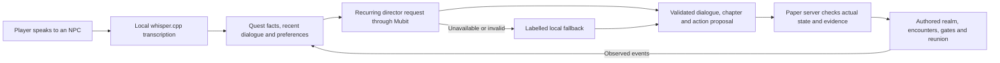
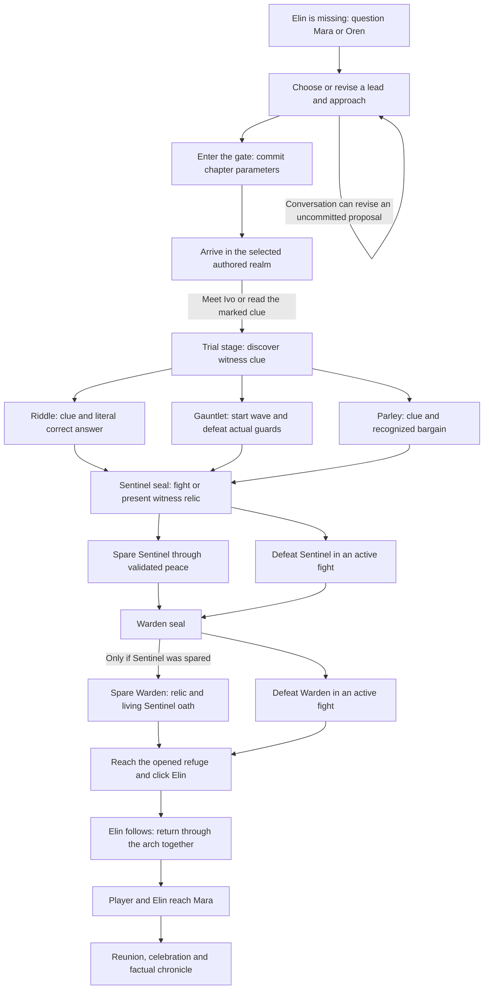

# The playable quest graph

EVERAFTER converts a conversation into a chapter proposal, then traverses a guarded quest graph inside Minecraft. The story starts with Elin missing and ends when she is physically reunited with Mara. The model supplies character dialogue and proposed choices; the game server decides whether a real action can advance the story.

This graph describes the implemented state machine. Runtime progression uses explicit conditions and state updates, not BFS, DFS or an LLM graph-search algorithm. The breadth-first search in the geometry tests checks walkability; it is not the narrative engine.

## Creator verification update — 25 October 2026

The creator reports having verified **effectively unlimited stories and worlds shaped by player preferences**, together with **improved results from the Mubit adapter**. This is a qualitative creator report; no exhaustive world count or numerical before/after benchmark was supplied. The graph, content table and validation below describe the checked-in implementation and archived tests.

## From conversation to consequences

The stable [director prompt](../director/prompt.mjs) defines the recurring task. Player-specific state belongs in user context. The [Node director](../director/director.mjs) validates the reply and preserves committed parameters; the [Paper plugin](../plugin/src/main/java/ai/everafter/EverafterPlugin.java) separately owns progression. Voice synthesis is a separate subsystem described in [architecture](architecture.md).

## Branches from the missing sister to the reunion

Only the committed trial branch is playable in a particular chapter. A model saying that a boss died or Elin is home cannot move the player along an edge.

## What makes an edge valid

| Transition | Implemented guard |
|---|---|
| Planning → construction | No build or dialogue is pending; completed stories do not start another chapter. Realm, trial, twist, route, mood and difficulty become fixed. |
| Arrival → trial | Meeting Ivo or reading the clue advances the stage. Meeting Ivo is not a separate mandatory gate. |
| Riddle → Sentinel | The actual witness clue was discovered and the player's literal message contains the canonical answer. The model's answer field alone cannot clear it. |
| Gauntlet → Sentinel | The clue was discovered, a wave was started, and no guards remain. |
| Parley → Sentinel | The clue was discovered and a recognized bargain was requested. The implementation does not semantically grade the argument's eloquence. |
| Sentinel → Warden | Peace requires the actual tagged inventory relic; combat requires the expected active boss and an entity-death event. |
| Warden → refuge | The same combat guards apply. Peace additionally requires that the Sentinel was spared. Killing the Sentinel removes this peaceful option. |
| Refuge → escort | An Elin click is valid only during the adventure's rescue stage. |
| Escort → complete | The return-home step occurred, then both player and Elin are near Mara. The ending records the actual guardian outcomes. |

Actions require an existing target within six blocks. Conversation may continue at greater distance. A valid peace offer can end an active fight; starting combat does not make peace irrevocable. Death preserves equipment/evidence and opened seals. `/ea home` permits retreat; `/ea go` returns to the existing chapter without resetting earned progress.

The implementation lives in `go`, `applyAction`, `readClue`, `finishTrial`, `rescue`, `home`, `complete` and the nested `Quest` class of [EverafterPlugin.java](../plugin/src/main/java/ai/everafter/EverafterPlugin.java). [QuestProgressTest.java](../plugin/src/test/java/ai/everafter/QuestProgressTest.java) exercises the transition guards and outcome dependencies.

## Current content space

| Dimension | Implemented values |
|---|---|
| Realm | Ember Keep, Sunken Archive, Sky Monastery, Thornwild |
| Trial | Riddle, gauntlet, parley |
| Twist | Broken oath, false trail, willing guardian |
| Approach | Mystery, combat, hybrid |
| Atmosphere | Eerie, wonder |
| Difficulty | 1, 2, 3 |

Four realms × three trials × three twists gives **36 categorical chapter configurations**. These are not 36 independently generated maps or 36 completed native playthroughs. `WorldBuilder.buildChapter` receives realm, trial, mood and difficulty; twist labels affect narrative interpretation and the ending rather than generating new terrain. Generated titles, hooks and dialogue add language variation without expanding the authored geometry catalogue.

The legal final guardian outcome pairs are **spare/spare, spare/defeat and defeat/defeat**. Defeat/spare is blocked by the Warden's living-oath requirement. These outcomes change the chronicle and reunion dialogue.

## Validation and expansion

[WorldBuilderGeometryTest.java](../plugin/src/test/java/ai/everafter/WorldBuilderGeometryTest.java) checks 24 realm/trial/mood combinations with stage partitions, accessible reading positions and an escort road. [Story tests](../director/test/story.test.mjs) cover the 36 categorical chapter choices and committed parameters. [Native validation](story-v2-validation.md) records an Ember campaign completed with user assistance for combat; automated coverage is not a native playthrough of every branch.

The creator's verification of effectively unlimited story and world variety is recorded above. The checked-in state machine builds one committed adventure per server run. A persistent sequence of linked chapters is a separate expansion: a composer would choose new chapter nodes while preserving evidence, commitments and a reachable ending. That requires additional world modules, transition rules, persistence and validation.
