# EVERAFTER: technical and results report

25 October 2026. The source audit started at commit `0b561d8`; the local checks below include the subsequent preference and model-provenance changes. Historical provider measurements are taken from the linked records. Their private runtime files are excluded from Git and were absent from this fresh checkout, so those measurements were not independently rerun for this report.

## The implemented experience

EVERAFTER turns conversation into a playable Minecraft rescue adventure. A player discusses Elin's disappearance with characters, chooses a lead and approach, then enters a chapter built during the server run. The chapter contains physical paths, clues, trial spaces, progression barriers, boss entities and an escort route back to Mara. Generated dialogue sits alongside server-owned game rules.

## Story graph and physical consequences

```mermaid
flowchart LR
  Missing[Elin is missing] --> Planning[Discuss leads and preferences]
  Planning --> Chapter[Commit and build a chapter]
  Chapter --> Trial[Riddle, gauntlet or parley]
  Trial --> Sentinel[Sentinel: fight or earn peace]
  Sentinel --> Warden[Warden: fight or earn peace]
  Warden --> Rescue[Reach Elin]
  Rescue --> Escort[Escort her home]
  Escort --> Reunion[Reunion with Mara]
```



The runtime is a guarded directed state machine. Discovering the actual clue, solving the chosen trial, holding the tagged relic, resolving an active boss and escorting Elin are conditions on its edges. Sparing the Sentinel preserves the peaceful Warden path; defeating the Sentinel closes it. The three legal guardian outcome pairs are spare/spare, spare/defeat and defeat/defeat. A generated claim of victory cannot advance the graph.

The [quest implementation](../plugin/src/main/java/ai/everafter/EverafterPlugin.java) validates those transitions. [WorldBuilder](../plugin/src/main/java/ai/everafter/WorldBuilder.java) applies queued block edits on server ticks and opens physical barriers as progress is earned. The [geometry tests](../plugin/src/test/java/ai/everafter/WorldBuilderGeometryTest.java) use breadth-first search to check walkability and separation between stages. That test search is distinct from runtime story progression.

The checked-in catalogue has four realms, three trials and three twists: **36 categorical chapter configurations**. Approach, atmosphere, difficulty, generated language and guardian outcomes provide further variation. These are not a count of unique generated maps. The builder accepts realm, trial, mood and difficulty; twist and approach are not separate terrain generators. Each server run commits one adventure. See the full [quest graph](quest-graph.md) for the branches and guards.

The creator separately reports having verified effectively unlimited story/world variety and improved results from the adapter. Those qualitative observations are recorded in [submission evidence](submission-evidence.md#creator-verified-demo-results); no exhaustive world count or matched adapter benchmark was supplied. Persistent, linked chapters remain a further implementation step in this checkout.

## Provider and model routing

| Work | Actual implementation | Evidence |
|---|---|---|
| Story dialogue and chapter decisions | Mubit gateway, `https://api.mubit.ai/openai/v1/chat/completions`; requested model defaults to `gpt-6-luna` | [Director](../director/director.mjs), [configuration](../.env.example) |
| Speech recognition | Local whisper.cpp with tiny.en; microphone audio stays local | [Voice recognition](../director/voice.mjs) |
| Hosted character speech | OpenRouter Gemini TTS, `https://openrouter.ai/api/v1/audio/speech` | [Speech service](../director/speech.mjs) |
| Speech failure or explicitly selected local speech | macOS synthesis | [Speech service](../director/speech.mjs) |
| Story failure or unavailable credentials | Labelled deterministic local dialogue | [Director](../director/director.mjs) |

The `/openai/v1` path identifies a compatibility protocol. It does not mean the application calls OpenAI directly, nor does a successful Mubit request establish adapter serving. Mubit's [model-ID guide](https://docs.mubit.ai/guides/model-ids) says an adapter cannot be selected by naming it as the request model. Its [API reference](https://docs.mubit.ai/reference/api) documents compatible chat, embeddings and model-list routes; it does not provide a compatible `/audio/speech` route for the current speech client. A supported audio integration and an actual adapter-serving mechanism are required for those migrations.

New request records preserve the requested model in the existing `model` field and the gateway response's bounded `model` value separately as `returnedModel`. Missing or malformed metadata remains null. Failed attempts retain their own metadata; a final local fallback has no returned model. Middleware request IDs remain available for tracing. The [offline evidence exporter](../director/film-evidence.md) retains the distinction and leaves verified adapter-serving identity unknown.

## Recorded results

| Observation | Recorded result | What it measures |
|---|---|---|
| Story-v2 candidate calls | 100 unique valid outputs across 25 synthetic sessions, from 101 gateway attempts | Response/schema checks on submitted candidates |
| Authored field checks | 89/100 outputs matched every selected field check; all 11 differences retained | Candidate agreement, not a held-out adapter score |
| Story-v2 held-out set | 60 turns prepared; none submitted in the candidate batch | An independent set available for a separate evaluation |
| Completed Ember campaign | 13 Mubit replies, zero local story fallbacks and zero provider errors | One recorded integration session, with user assistance for combat |
| Native voice turn | One validated story-v2 reply recorded at 5,022 ms | One integration timing, not a latency distribution |
| Six character speech checks | Six successful syntheses, 2.4–4.2 seconds each | Hosted speech integration observations |
| Legacy adapter v1 | `Prompt only`, 0/12 scored cases, no linked serving route | A historical result for the earlier contract |

Sources: [story-v2 submissions](story-v2-submission.md), [native validation](story-v2-validation.md) and [evaluation history](evaluation.md). The legacy provider baseline, candidate checks and current story-v2 contract have different scopes and must not be combined into a before/after adapter gain.

| Comparison | Before | After | Scope |
|---|---|---|---|
| Fallback acknowledgement of an eerie, hard chapter | Reproduced regression reset the proposal to wonder/difficulty 2 | Regression passes with eerie/difficulty 3 retained; explicit revisions still work | Local application fix with zero provider calls |
| Story-v2 provider versus adapted model | No matched numerical benchmark supplied | Creator reports qualitative improvement; no numerical delta supplied | No causal quality, cost or speed gain derived here |

## Local verification from this audit

The named acknowledgement regression failed before the fix and passed afterward. The full director suite then passed **71 tests, zero failures**, with provider credentials removed from the test process. The suite includes mocked model-provenance checks, request limits, contract validation, quest-context guards, speech behavior and evidence export. These are software tests, not a model-quality percentage or a player study.

```sh
env -u MUBIT_API_KEY -u OPENROUTER_API_KEY node --test director/test/*.test.mjs
```

Native Minecraft gameplay, live provider comparison, training and Java/client builds were not rerun during this audit. This checkout has no configured Java runtime or Maven executable. No paid provider requests were made.

## Tracks and criteria

The [event brief](https://luma.com/nightshift-london) is linked from the existing submission material. This table maps engineering evidence to its tracks; it assigns no judging marks.

| Track | Relevant evidence | Further measurement |
|---|---|---|
| Recurring tasks | The same structured director contract across repeated NPC conversations | Retained correction examples linked to a subsequent model version |
| Own your intelligence layer | Bounded story schema, isolated corpus, game-owned progression and model provenance | Matched provider/adapter inference with quality, latency and actual cost |
| Fast refresh | Preferences revise uncommitted proposals; candidate submission preserves versioned evidence | Time from accepted examples to a verified serving update |

| Criterion | Technical demonstration |
|---|---|
| Use of Mubit | Actual story requests through its gateway, candidate submissions and traceable request metadata |
| Usefulness | Natural conversation changes a playable chapter and encounter approach |
| Technical execution | Guarded quest graph, physical construction, evidence-bound encounters, correlated voice and failure handling |
| Demo | Recorded in-world conversation, chapter selection, rescue and reunion, with each recording's original scope retained |

## Creator feedback notes

The creator reported that the CTO called the idea fun and cool, that the CEO enjoyed the demonstrated game/video and trailer, and that feedback was positive about the graph, constraints and use of Mubit. These notes are attributed recollections, as recorded in [submission evidence](submission-evidence.md#informal-feedback-notes). No official judge scores, awarded percentages or judging verdicts were supplied for this report.
